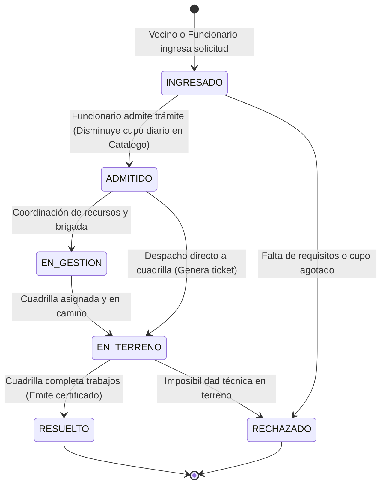

# 🏛️ Arquitectura del Sistema: BarrioDigital

## 1. Visión General
**BarrioDigital** es una plataforma cloud-native orientada a eventos para la gestión de trámites comunales y atención vecinal de una red de 20 oficinas comunales y juntas de vecinos. 

El sistema implementa:
* **Autenticación e IDaaS:** Microsoft Entra ID (Azure Active Directory) con OAuth 2.0 y OpenID Connect.
* **Frontend:** Angular 18/22 con `@azure/msal-angular` y `@azure/msal-browser` (PKCE).
* **Puerta de Enlace Nube:** AWS API Gateway (HTTP API) con JWT Authorizer.
* **Backend:** Microservicios en Java 17 con Spring Boot 3.3.0 estructurados tras un patrón BFF (Backend For Frontend).
* **Colas de Tareas:** Clúster de RabbitMQ (2 nodos) con DLQ y política de Dead Letter Exchange.
* **Streaming y Auditoría:** Clúster de Apache Kafka (3 brokers) con Apache Zookeeper (3 nodos).
* **Despliegue:** Contenedores Docker orquestados con Docker Compose en instancias EC2.

---

## 2. Mapa de Microservicios

| Microservicio | Puerto Interno | Dominio / Base de Datos | Responsabilidad Principal |
| :--- | :--- | :--- | :--- |
| **ms-barriodigital-bff** | `8080` | Stateless (Spring Security) | BFF Gateway, valida firma JWT con Azure JWKS, extrae roles y enruta hacia los microservicios. |
| **ms-barriodigital-requests** | `8081` | Trámites / Oracle & H2 | CRUD de trámites, máquina de estados, validación de reglas de negocio, publicación en RabbitMQ y Kafka. |
| **ms-barriodigital-catalog** | `8082` | Catálogo / Oracle & H2 | Administración de tipos de trámite, requisitos y control de cupos diarios disponibles. |
| **ms-barriodigital-notify** | `8083` | Notificaciones / Sin DB | Consumidor asíncrono de RabbitMQ (`q.cmd.email`, `q.cmd.crew`, `q.cmd.certificate`). |
| **ms-barriodigital-report** | `8084` | Reportería / Oracle & H2 | Consumidor Kafka (`requests.events`). Agrega KPIs en tiempo real sin bloquear el core transaccional. |
| **ms-barriodigital-audit** | `8085` | Auditoría / Oracle & H2 | Consumidor Kafka (`requests.events`, `audit.timeline`). Mantiene el historial inmutable de eventos. |

---

## 3. Máquina de Estados del Trámite y Reglas de Negocio

El ciclo de vida de un trámite transita por los siguientes estados:



### Reglas Clave Implementadas en Código:
1. **Regla de Terreno:** `No se puede pasar a EN_TERRENO sin haber sido previamente ADMITIDO o puesto EN_GESTIÓN`.
2. **Regla de Cupos:** `El cupo diario disponible disminuye automáticamente al admitir el trámite (INGRESADO -> ADMITIDO)`.
3. **Notificación al Vecino:** Cada cambio de estado emite un comando AMQP a `q.cmd.email` mediante envelope estructurado.
4. **Ticket de Cuadrilla:** Al pasar a `EN_TERRENO`, se publica un comando a `q.cmd.crew`.
5. **Certificado Digital:** Al pasar a `RESUELTO`, se publica un comando a `q.cmd.certificate`.

---

## 4. Topología de Mensajería: RabbitMQ (Colas de Tareas)

* **Exchanges configurados:**
  * `cmd.direct` (Direct Exchange para enrutamiento exacto)
  * `cmd.topic` (Topic Exchange para patrones `#` y `*`)
  * `cmd.dead.dlx` (Direct Exchange para canalizar Dead Letter Queues)

| Cola Principal | Propósito | Routing Key Direct | Routing Key Topic | Cola DLQ asociada |
| :--- | :--- | :--- | :--- | :--- |
| **`q.cmd.email`** | Email/push al vecino (admitido, resuelto) | `email.send` | `email.*` | `q.cmd.email.dlq` |
| **`q.cmd.crew`** | Ticket de visita a cuadrilla en terreno | `crew.ticket` | `crew.#` | `q.cmd.crew.dlq` |
| **`q.cmd.certificate`** | Generación de comprobante/certificado PDF | `certificate.gen` | `certificate.*` | `q.cmd.certificate.dlq` |

---

## 5. Topología de Streaming: Apache Kafka

| Tópico | Particiones | Réplicas | Política de Limpieza | Retención | Propósito |
| :--- | :--- | :--- | :--- | :--- | :--- |
| **`requests.events`** | 3 | 3 | `delete` | 7 días | Fuente de verdad de cambios de estado para reportería y auditoría. |
| **`audit.timeline`** | 3 | 3 | `compact,delete` | 30 días | Registro inmutable de eventos con trazabilidad de actores y horas. |
| **`requests.events.DLT`** | 3 | 3 | `delete` | 14 días | Dead Letter Topic para eventos que fallen tras 3 reintentos. |

---

## 6. Estructura del Envelope Común de Mensajes

Tanto RabbitMQ como Kafka utilizan un envelope estándar:
```json
{
  "type": "REQUEST_STATUS_UPDATED",
  "eventId": "e9b25184-7a3b-4c28-9844-3c66f5728a11",
  "timestamp": "2026-11-16T10:15:30.123Z",
  "traceId": "c4d29f11-0982-4aa3-8821-2e8f1100234a",
  "correlationId": "f711204a-8821-4ba2-9211-1a2b3c4d5e6f",
  "payload": {
    "requestId": 1,
    "trackingNumber": "REQ-2026-0001",
    "procedureId": 1,
    "procedureName": "Poda de Árboles en Vía Pública",
    "status": "EN_TERRENO",
    "oldStatus": "ADMITIDO",
    "assignedCrew": "Cuadrilla #2 - Despeje Vial",
    "actor": "mariana.funcionario@barriodigital.cl",
    "timestamp": "2026-11-16T10:15:30"
  }
}
```
