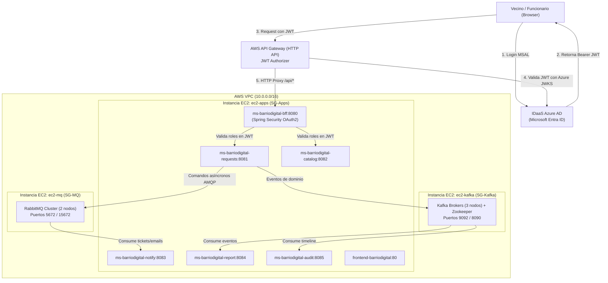

# ☁️ Guía de Despliegue en AWS: EC2 + API Gateway (HTTP API con JWT Authorizer)

Esta guía documenta el despliegue del sistema **BarrioDigital** en **Amazon Web Services (AWS)** con autenticación delegada a **Azure Active Directory (Microsoft Entra ID)**.

---

## 1. Arquitectura de Despliegue en AWS



---

## 2. Opción A: Despliegue Automatizado con CloudFormation

En la carpeta `infra/aws/` se incluyen las plantillas oficiales listas para ejecutar en la consola de AWS o AWS CLI:

### Paso 1: Crear la Red e Instancias EC2
```bash
aws cloudformation create-stack \
  --stack-name barriodigital-ec2-stack \
  --template-body file://infra/aws/cloudformation-ec2.yaml \
  --parameters ParameterKey=KeyPairName,ParameterValue=mi-llave-ssh \
  --capabilities CAPABILITY_IAM
```
Al finalizar, obtendrá las IPs públicas y privadas de `ec2-apps`, `ec2-mq` y `ec2-kafka`.

### Paso 2: Crear el AWS API Gateway con JWT Authorizer
```bash
aws cloudformation create-stack \
  --stack-name barriodigital-apigw-stack \
  --template-body file://infra/aws/cloudformation-apigw.yaml \
  --parameters \
    ParameterKey=AzureTenantId,ParameterValue=TU_AZURE_TENANT_ID \
    ParameterKey=AzureApiClientId,ParameterValue=TU_AZURE_BACKEND_CLIENT_ID \
    ParameterKey=BackendBffUrl,ParameterValue=http://IP_PUBLICA_EC2_APPS:8080
```
La salida (`ApiGatewayEndpoint`) entregará la URL final de producción.

---

## 3. Opción B: Despliegue Manual Paso a Paso en la Consola AWS

### Paso 1: Configurar Security Groups (Principio de Menor Privilegio)
1. **`sg-barriodigital-apps` (ec2-apps):**
   * Puerto 22 (SSH): Permitido solo a tu IP.
   * Puerto 80 (HTTP): `0.0.0.0/0` (Portal Web Angular).
   * Puerto 8080 (BFF): `0.0.0.0/0` (Consumo desde AWS API Gateway).
2. **`sg-barriodigital-mq` (ec2-mq):**
   * Puerto 22 (SSH): Tu IP.
   * Puerto 5672 (AMQP): Origen restringido a `sg-barriodigital-apps`.
   * Puerto 15672 (RabbitMQ Management): Tu IP.
3. **`sg-barriodigital-kafka` (ec2-kafka):**
   * Puerto 22 (SSH): Tu IP.
   * Puerto 9092 (Kafka): Origen restringido a `sg-barriodigital-apps`.
   * Puerto 8090 (Kafka UI): Tu IP.

### Paso 2: Configurar AWS API Gateway (HTTP API) con JWT Authorizer
1. En la consola de AWS, vaya a **API Gateway** &rarr; **Create API** &rarr; **HTTP API** &rarr; **Build**.
2. **API Name:** `BarrioDigital-ApiGateway`.
3. Configure **CORS**:
   * Allow origins: `*`
   * Allow methods: `GET, POST, PUT, DELETE, OPTIONS`
   * Allow headers: `Authorization, Content-Type, X-User-Email, X-User-Name, X-Actor-Email`
4. Cree el **JWT Authorizer**:
   * Menú lateral &rarr; **Authorization** &rarr; **Manage authorizers** &rarr; **Create**.
   * Tipo: **JWT**.
   * **Name:** `AzureAD-Authorizer`.
   * **Identity source:** `$request.header.Authorization`.
   * **Issuer URL:** `https://login.microsoftonline.com/<TU_AZURE_TENANT_ID>/v2.0`
   * **Audience:** Agregue dos valores:
     1. `api://<TU_AZURE_BACKEND_CLIENT_ID>`
     2. `<TU_AZURE_BACKEND_CLIENT_ID>`
5. Cree las Rutas e Integración:
   * **Ruta:** `ANY /api/{proxy+}`.
   * **Authorizer:** Seleccione `AzureAD-Authorizer`.
   * **Integration Target:** `HTTP PROXY` &rarr; `http://<IP_EC2_APPS>:8080/{proxy}`.

---

## 4. Ejecución de Contenedores en EC2

Conéctese por SSH a cada instancia y lance los contenedores:

### En `ec2-mq`:
```bash
git clone https://github.com/TU_USUARIO/BarrioDigital.git
cd BarrioDigital/infra/mq
docker-compose up -d
```
Verifique en `http://<IP_EC2_MQ>:15672` (usuario: `guest`, clave: `guest`) que las 6 colas y 3 exchanges estén creados.

### En `ec2-kafka`:
```bash
cd BarrioDigital/infra/kafka
docker-compose up -d
```
Verifique en `http://<IP_EC2_KAFKA>:8090` que los tópicos `requests.events` y `audit.timeline` estén operativos con 3 particiones y 3 réplicas.

### En `ec2-apps`:
```bash
cd BarrioDigital/infra/apps
export RABBITMQ_HOST=<IP_PRIVADA_EC2_MQ>
export KAFKA_BOOTSTRAP_SERVERS=<IP_PRIVADA_EC2_KAFKA>:9092
export AZURE_TENANT_ID=<TU_TENANT_ID>
export AZURE_CLIENT_ID=<TU_CLIENT_ID>
docker-compose up -d --build
```

---

## 5. Pruebas de Funcionamiento en la Nube

1. **Prueba de Bloqueo 401 Unauthorized:**
   Consuma el endpoint de API Gateway sin token:
   ```bash
   curl -i https://<api-id>.execute-api.us-east-1.amazonaws.com/api/catalog/procedures
   ```
   **Resultado esperado:** `401 Unauthorized` generado por el JWT Authorizer de AWS.

2. **Prueba con Token Válido de Azure AD:**
   Consuma el endpoint adjuntando el Bearer token obtenido tras login con MSAL:
   ```bash
   curl -i -H "Authorization: Bearer <ACCESS_TOKEN>" \
     https://<api-id>.execute-api.us-east-1.amazonaws.com/api/catalog/procedures
   ```
   **Resultado esperado:** `200 OK` con el listado de trámites comunales y cupos.

3. **Prueba de Autorización por Rol (403 Forbidden):**
   Si un usuario con rol `Vecino` intenta crear un tipo de trámite (`POST /api/catalog/procedures`), el Spring Boot BFF responde `403 Forbidden` con mensaje estructurado en JSON.
