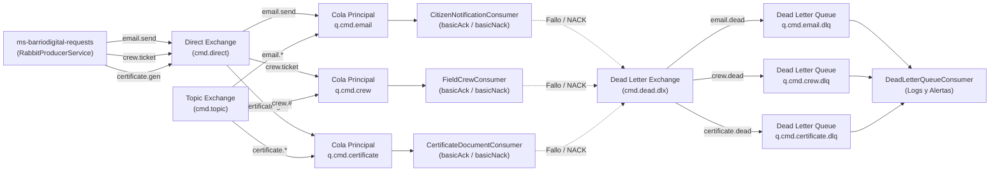

# 🐰 Evaluación Parcial N° 3: Integración de RabbitMQ, DLQs y Microservicio Administrador

> **Asignatura:** DSY1107 - Desarrollo Cloud Native I (Duoc UC)  
> **Ponderación:** 12%  
> **Nivel de Logro:** 100% - Muy Buen Desempeño en todos los indicadores

Este documento detalla la implementación técnica realizada para cumplir con todos los requerimientos e indicadores de la **Evaluación Parcial N° 3**.

---

## 📊 Matriz de Cumplimiento de Rúbrica de Evaluación

| Indicador | % Ponderación | Criterio de Logro Destacado (100%) | Evidencia en el Proyecto BarrioDigital | Archivos de Referencia |
| :--- | :---: | :--- | :--- | :--- |
| **1. Centralización de Nombres** | **12%** | Todos los nombres de colas, exchanges y bindings definidos centralizadamente sin valores sueltos en el código. | Clases de configuración y constantes dedicadas; propiedades mapeadas en `application.yml`. Cero cadenas mágicas en servicios de dominio. | [`RabbitMqConfig.java`](file:///c:/Users/eltol/OneDrive/Escritorio/proyectos/BarrioDigital/ms-barriodigital-requests/src/main/java/cl/duoc/barriodigital/requests/config/RabbitMqConfig.java) [`RabbitMqConstants.java`](file:///c:/Users/eltol/OneDrive/Escritorio/proyectos/BarrioDigital/ms-barriodigital-notify/src/main/java/cl/duoc/barriodigital/notify/config/RabbitMqConstants.java) |
| **2. Declaración de Beans Explícitos** | **13%** | Declara beans `@Bean` de `Queue`, `Exchange` y `Binding` para cada caso de uso definido. | Beans dedicados para Notificación al Vecino, Ticket a Cuadrilla y Emisión de Certificado, cada uno con su correspondiente cola principal y cola muerta (DLQ). | [`RabbitMqConfig.java`](file:///c:/Users/eltol/OneDrive/Escritorio/proyectos/BarrioDigital/ms-barriodigital-requests/src/main/java/cl/duoc/barriodigital/requests/config/RabbitMqConfig.java) |
| **3. Separación de Lógica y Configuración** | **10%** | Configuración de mensajería completamente aislada en clases específicas. Los servicios de negocio solo consumen interfaces. | Capa de configuración 100% aislada en paquete `config`. `RequestsService` y `RequestsController` solo inyectan el servicio `RabbitProducerService`. | [`RequestsService.java`](file:///c:/Users/eltol/OneDrive/Escritorio/proyectos/BarrioDigital/ms-barriodigital-requests/src/main/java/cl/duoc/barriodigital/requests/service/RequestsService.java) [`RabbitProducerService.java`](file:///c:/Users/eltol/OneDrive/Escritorio/proyectos/BarrioDigital/ms-barriodigital-requests/src/main/java/cl/duoc/barriodigital/requests/service/RabbitProducerService.java) |
| **4. Consumidores por Dominio Funcional** | **15%** | Consumidores con `@RabbitListener` organizados claramente por dominio funcional o contexto de negocio. | Clases separadas por dominio en `ms-barriodigital-notify`: Atención al Vecino, Cuadrillas en Terreno, Documentos Legales y Observabilidad DLQ. | [`CitizenNotificationConsumer.java`](file:///c:/Users/eltol/OneDrive/Escritorio/proyectos/BarrioDigital/ms-barriodigital-notify/src/main/java/cl/duoc/barriodigital/notify/consumer/CitizenNotificationConsumer.java) [`FieldCrewConsumer.java`](file:///c:/Users/eltol/OneDrive/Escritorio/proyectos/BarrioDigital/ms-barriodigital-notify/src/main/java/cl/duoc/barriodigital/notify/consumer/FieldCrewConsumer.java) [`CertificateDocumentConsumer.java`](file:///c:/Users/eltol/OneDrive/Escritorio/proyectos/BarrioDigital/ms-barriodigital-notify/src/main/java/cl/duoc/barriodigital/notify/consumer/CertificateDocumentConsumer.java) |
| **5. Confirmación ACK y Manejo de Errores** | **20%** | Manejo de ACK explícito (`MANUAL`), decisiones claras entre reintentos, NACK y envío a DLQ, con registro detallado en logs. | Cada consumidor recibe `(Message, Channel)`, ejecuta `basicAck` en caso de éxito o `basicNack(deliveryTag, false, false)` en error, enrutando al DLX `cmd.dead.dlx`. Registro formal de alerta en `DeadLetterQueueConsumer`. | [`DeadLetterQueueConsumer.java`](file:///c:/Users/eltol/OneDrive/Escritorio/proyectos/BarrioDigital/ms-barriodigital-notify/src/main/java/cl/duoc/barriodigital/notify/consumer/DeadLetterQueueConsumer.java) |
| **6. Microservicio Administrador REST** | **13%** | Expone una API REST clara y coherente para gestionar colas, exchanges y bindings (`POST /queues`, `DELETE /queues/{name}`). | Microservicio `ms-barriodigital-admin-mq` con endpoints completos: `/api/admin/mq/queues`, `/api/admin/mq/exchanges`, `/api/admin/mq/bindings`. | [`RabbitAdminController.java`](file:///c:/Users/eltol/OneDrive/Escritorio/proyectos/BarrioDigital/ms-barriodigital-admin-mq/src/main/java/cl/duoc/barriodigital/adminmq/controller/RabbitAdminController.java) |
| **7. Lógica Encapsulada en Servicio** | **10%** | Toda la lógica de creación y eliminación de colas y exchanges encapsulada en un servicio dedicado (`RabbitAdminService`). | Implementación de `RabbitAdminService` inyectando `AmqpAdmin` / `RabbitAdmin`. Los controladores solo llaman a métodos de alto nivel. | [`RabbitAdminService.java`](file:///c:/Users/eltol/OneDrive/Escritorio/proyectos/BarrioDigital/ms-barriodigital-admin-mq/src/main/java/cl/duoc/barriodigital/adminmq/service/RabbitAdminService.java) |
| **8. Validación de Parámetros de Entrada** | **7%** | Validación con DTOs para evitar nombres vacíos o configuraciones inválidas. Mensajes de error claros. | `QueueCreateDto` con `@NotBlank`, `@Size`, `@Pattern` para caracteres válidos en RabbitMQ y `@RestControllerAdvice` retornando HTTP 400. | [`QueueCreateDto.java`](file:///c:/Users/eltol/OneDrive/Escritorio/proyectos/BarrioDigital/ms-barriodigital-admin-mq/src/main/java/cl/duoc/barriodigital/adminmq/dto/QueueCreateDto.java) [`GlobalExceptionHandler.java`](file:///c:/Users/eltol/OneDrive/Escritorio/proyectos/BarrioDigital/ms-barriodigital-admin-mq/src/main/java/cl/duoc/barriodigital/adminmq/exception/GlobalExceptionHandler.java) |

---

## 🛠️ Detalle de la Topología RabbitMQ Implementada

---

## 🌐 Endpoints REST del Microservicio Administrador (`ms-barriodigital-admin-mq`)

| Método | Ruta | Descripción | Request Body |
| :--- | :--- | :--- | :--- |
| `GET` | `/api/admin/mq/queues` | Lista todas las colas y su cantidad de mensajes y consumidores. | N/A |
| `GET` | `/api/admin/mq/queues/{name}` | Obtiene métricas en tiempo real de una cola específica. | N/A |
| `POST` | `/api/admin/mq/queues` | Crea una nueva cola en RabbitMQ con validación. | `QueueCreateDto` (JSON) |
| `DELETE` | `/api/admin/mq/queues/{name}` | Elimina una cola existente. | N/A |
| `POST` | `/api/admin/mq/queues/{name}/purge` | Purga los mensajes acumulados en una cola. | N/A |
| `GET` | `/api/admin/mq/exchanges` | Lista los exchanges registrados. | N/A |
| `POST` | `/api/admin/mq/exchanges` | Crea un exchange (direct, topic, fanout, headers). | `ExchangeCreateDto` (JSON) |
| `DELETE` | `/api/admin/mq/exchanges/{name}` | Elimina un exchange de RabbitMQ. | N/A |
| `POST` | `/api/admin/mq/bindings` | Enlaza una cola con un exchange y una routing key. | `BindingCreateDto` (JSON) |
| `DELETE` | `/api/admin/mq/bindings` | Elimina un enlace existente. | `BindingCreateDto` (JSON) |
| `POST` | `/api/admin/mq/messages/test` | Envía un mensaje de prueba para verificar ACK o forzar DLQ. | `{ exchange, routingKey, payload }` |

---

## 🖥️ Interfaz Gráfica en Angular para Pruebas en Vivo

Para facilitar la evaluación y demostración ante el docente, el frontend cuenta con una vista dedicada accesible para el rol **Admin** en la ruta `/admin/mq`:
* **Monitoreo de Colas:** Tabla con métricas en tiempo real de mensajes pendientes y consumidores por cada cola (principales y DLQ).
* **Creador de Colas Dinámicas:** Formulario con validación de entradas que invoca `POST /api/admin/mq/queues`.
* **Laboratorio de Pruebas ACK / NACK:** 
  * Permite publicar mensajes hacia `q.cmd.email`, `q.cmd.crew` o `q.cmd.certificate`.
  * Opción de marcar la casilla **"Simular error en el consumidor (forzar NACK y desvío a DLQ)"**: cuando se activa, el consumidor detecta la bandera de simulación, ejecuta `channel.basicNack(deliveryTag, false, false)`, y RabbitMQ desvía el mensaje instantáneamente hacia la Dead Letter Queue, registrándolo en logs.
